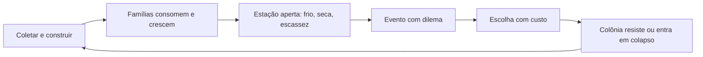

# RECLAIM · Game Design Document

Versão 2.0 · outubro de 2026 · documento vivo, atualizado a cada marco concluído.

Autora: Laryssa Aguiar Menjon (design, programação, UI/UX). Projeto solo.

> "O peso de liderar não está no concreto das calçadas, mas nas vidas de quem caminha sobre elas."

## 1. Identidade

| Campo | Valor |
|---|---|
| Título | RECLAIM |
| Frase | Reconstrua o mundo. Pague o preço. |
| Gênero | City builder de sobrevivência com dilemas morais |
| Câmera | 3D isométrica livre (referências: Manor Lords, Farthest Frontier, Frostpunk) |
| Engine | Unity 6.6 (6000.6), URP, Input System novo |
| Plataforma | PC (Windows) na Steam |
| Público | Quem gosta de construir e administrar e quer que as decisões tenham peso humano |
| Fase | Alpha em produção |

### 1.1 Conceito

O jogador lidera um grupo de famílias sobreviventes num mundo que colapsou. O objetivo é transformar um acampamento frágil numa colônia que atravessa o inverno. A proposta central é que nenhuma escolha seja puramente matemática: racionar água salva o estoque, mas quebra a moral de uma família; aceitar migrantes traz braços e mais bocas.

Fantasia do jogador: "quero sentir que estou reconstruindo o mundo do zero e que cada decisão pode salvar ou condenar minha cidade".

### 1.2 Pilares

1. **Peso emocional.** Toda decisão tem custo humano visível nas famílias.
2. **Escassez administrada.** Recurso nunca sobra por acaso; o estoque é medido em dias de reserva.
3. **O clima é o inimigo.** No alpha a pressão vem do frio, da seca e da falta de suprimentos, não de combate.
4. **Crescimento orgânico.** A colônia cresce como uma comunidade, não como uma árvore de upgrades.
5. **Narrativa emergente.** As histórias nascem da simulação e dos dilemas, não de roteiro fixo.

### 1.3 O que mudou desde a v1

- Hordas de zumbis, defesa, munição e milícia saem do alpha. A tensão crescente vem das estações e da escassez.
- A equipe agora é só a autora. O escopo foi cortado para caber em uma pessoa usando assets prontos.
- O ano tem 80 dias, divididos em quatro estações de 20 dias, para casar com o redesign da HUD.
- A arquitetura de código foi unificada (seção 11). Dados que antes estavam escondidos no código viraram assets editáveis.
- A UI segue o design system "RECLAIM · Design System e Telas" no Figma.

## 2. Loop principal

**Minuto a minuto:** posicionar construções, abrir estradas, acompanhar a reserva de comida e água, responder a eventos.

**Dia a dia:** o relógio avança em ticks (96 por dia). A cada tick as famílias consomem, a moral reage e o diretor de eventos avalia se algo acontece. No início de cada dia é verificada a condição de derrota por moral.

**Estação a estação:** a temperatura média muda. O inverno é o teste de cada ano; primavera e verão são as janelas para estocar.

## 3. Escopo do alpha

| Entra no alpha | Fica para depois |
|---|---|
| Construção em grid com 3 estágios de obra e desfazer | Hordas, muros, torres, munição, milícia |
| Estradas com curva, ocupando o grid | Pesquisa e árvore tecnológica |
| Floresta com corte automático e regeneração | Expedições com equipe e mapa |
| Famílias com fome, saúde, moral, doença, nascimento e morte | Cidadão individual, energia, trabalho por slot |
| Clima por estação e frio afetando saúde e moral | Comércio com caravanas |
| Esperança coletiva da colônia | Save e load em arquivo |
| Eventos com dilema e escolhas com custo | Minimapa |
| Produção básica: poço e horta (próximo marco) | Diplomacia entre colônias |
| HUD do redesign do Figma | Modo sandbox |
| Novo Jogo: líder, mapa, dificuldade, cidade e bandeira | |

## 4. Tempo, estações e clima

| Item | Valor | Onde ajustar |
|---|---|---|
| Ticks por dia | 96 | `SimulationClock` |
| Segundos reais por tick em 1x | 0,5 (um dia dura 48 s) | `SimulationClock` |
| Velocidades | Pausa, 1x, 2x, 4x | `SimulationClock`, botões da HUD |
| Hora inicial da partida | 07:00 | `SimulationClock` |
| Ano | 80 dias: inverno, primavera, verão, outono, 20 dias cada | `SimulationClock` |
| Fases do dia | madrugada até 05:00, amanhecer 05:00, dia 07:00, entardecer 18:00, noite 20:00 | `DayNightCycle` |

A velocidade é aplicada em `Time.timeScale`. Assim obras, corte de árvores e animações param junto com a pausa, enquanto câmera e UI usam tempo não escalado e continuam respondendo.

A partida começa no inverno. É proposital: o primeiro inverno ensina o jogo sob pressão e a primavera vem como alívio.

### 4.1 Temperatura

Cada mapa tem um `ClimateProfile` com a média de cada estação. A transição entre estações é suave e a variação diária segue um cosseno, com a hora mais fria às 05:00.

| Estação | Média do perfil padrão |
|---|---|
| Inverno | -10 °C |
| Primavera | 4 °C |
| Verão | 18 °C |
| Outono | 3 °C |

Variação diária padrão: 8 °C entre a hora mais fria e a mais quente.

## 5. Recursos

| Recurso | Tipo | Exibição na HUD | Início | Capacidade | Fonte no alpha | Consumo |
|---|---|---|---|---|---|---|
| Comida | Consumível | dias de reserva | 400 | 600 | Horta (próximo marco), eventos | 1 por morador por dia |
| Água | Consumível | dias de reserva | 450 | 700 | Poço (próximo marco), eventos | 1,2 por morador por dia |
| Madeira | Material | unidades | 120 | 500 | Floresta | Construções |
| Sucata | Material | unidades | 120 | 500 | Ruínas e eventos | Construções |
| Combustível | Material | unidades | 60 | 200 | Eventos (carvoaria depois) | Aquecimento (próximo marco) |
| Remédios | Material | unidades | 10 | 50 | Eventos | Tratamento de doença (próximo marco) |

Dias de reserva = estoque / consumo diário da população atual. Abaixo de 3 dias o contador entra no estado Baixo (vermelho).

Todos os valores estão nos assets de `Assets/Data/Config/Recursos`. O `ResourceStock` é a única fonte de verdade: construção, floresta, famílias e eventos passam por ele.

> Sem horta e poço, as reservas iniciais duram cerca de 15 dias para 7 famílias. Isso é esperado até o marco de produção.

## 6. Construção

- Grid quadrado sincronizado com o terreno; rotação em 4 direções com R.
- Custo em madeira e sucata cobrado no clique. Sem recursos, o fantasma fica vermelho e a construção é recusada.
- Três estágios visuais: fundação (início), estrutura (a partir de 50% do tempo) e concluída. Sem modelos de estágio, a obra sobe do chão até a altura final. Barra de progresso no mundo, com tamanho fixo na tela e os segundos que faltam.
- O tamanho no mundo vem do `Size` do BuildingData: o modelo (preview e todos os estágios) é ajustado à pegada, com `Footprint Fill` controlando a folga. Desligue `Fit To Footprint` para usar a escala original do modelo.
- Árvores dentro da área são cortadas e a madeira entra no estoque.
- Z desfaz a última construção e devolve o custo.
- Botão direito cancela a ferramenta.

### 6.1 Catálogo do alpha

| Construção | Tamanho | Madeira | Sucata | Função | Status |
|---|---|---|---|---|---|
| Casa pequena | 2x2 | 10 | 25 | Abriga 1 família | Asset existe |
| Casa grande | 2x2 | 40 | 25 | Abriga 4 famílias | Asset existe |
| Armazém | 2x2 | 10 | 5 | Aumenta a capacidade de estoque | Asset existe, efeito no próximo marco |
| Indústria | 2x2 | 20 | 15 | Reservado para produção | Asset existe, sem função ainda |
| Poço | 1x1 | 0 | 8 | Produz água com trabalhador | Próximo marco |
| Horta | 3x3 | 8 | 0 | Produz comida com trabalhador | Próximo marco |
| Barraca | 1x1 | 5 | 0 | Abrigo de emergência, 1 família | Próximo marco |

### 6.2 Estradas

Estilo Manor Lords. O jogador clica para colocar pontos e a estrada é uma curva suave (Hermite) entre eles. **Clicar e arrastar** ao colocar um ponto fixa a direção em que a estrada passa por ele (uma alça mostra a direção); sem arrastar, a curva se ajusta sozinha. Confirma no botão do martelo ou com Enter. Botão direito remove o último ponto; sem pontos, sai da ferramenta. A preview fica vermelha quando a estrada atravessa uma construção. A estrada pronta ocupa as células cobertas pela largura e não pode atravessar construções.

### 6.3 Começo do jogo, moradores e trabalho

- A colônia começa com as famílias em **barracas dispostas em círculo no meio do mapa**, sem casa. Pendências: uma casa por família, armazém e oficina, mais um lenhador e um catador designados. Elas aparecem na lista do canto da tela e não travam a simulação.
- Cada família vira moradores visíveis: homem, mulher e crianças. Cachorros circulam pelo acampamento sem função (figurativos).
- Moradores têm **autonomia**: quem tem ofício sai para o trabalho na hora certa (padrão 7h às 17h), executa o ciclo e volta sozinho; os demais circulam perto de casa; à noite todos dormem (em casa, somem de vista).
- O jogador **designa** o trabalho: com nenhuma ferramenta ativa, clica numa construção de trabalho pronta e aumenta ou diminui cada ofício. A oficina oferece Lenhador (2), Catador de sucata (2) e Plantador (1), definidos em `BuildingData.Job Slots`.
- Ofícios: o lenhador derruba a árvore mais próxima e leva a madeira à oficina; o catador recolhe montes de sucata e escombros do mapa e leva à oficina; o plantador replanta tocos.
- Quando uma casa fica pronta, uma família sem casa se muda e a barraca some.
- Prefabs: `Assets/Resources/SettlementSettings` tem os espaços de homem, mulher, criança, cachorro e barraca (e árvore, toco, muda, monte de sucata). Campo vazio usa um modelo simples gerado por código.

## 7. Floresta

| Estado | Descrição |
|---|---|
| De pé | Pode ser cortada |
| Cortada | Toco; fica assim até um plantador replantar |
| Crescendo | Muda que cresce sozinha até ficar de pé de novo |

As árvores são espalhadas ao iniciar a partida, em clareiras e esparsas, longe do acampamento. O corte é feito pelos lenhadores designados (a contagem automática por população foi desligada) e mostra "+N madeira" no mundo. Sucata e escombros também nascem espalhados e são recolhidos pelos catadores. Em volta do mapa há um anel de montanhas procedurais e névoa: o limite existe, mas o fim do mundo não aparece.

## 8. Famílias e necessidades

A população é organizada em famílias, com atributos de 0 a 100.

| Atributo | Efeito quando piora |
|---|---|
| Fome | Acima de 60 a saúde começa a cair |
| Saúde | Abaixo de 12 há chance de morte de membros |
| Moral | Média abaixo de 5 por 3 dias seguidos leva à derrota |
| Doença | Tira saúde e moral todos os dias até curar |

Regras atuais (`NeedsSystem`):

- A comida e a água disponíveis no tick são divididas igualmente entre as famílias. Se faltar, todas sentem o mesmo déficit.
- Frio abaixo da tolerância da família (padrão -8 °C) tira saúde e moral e aumenta a chance de doença.
- Uma família bem alimentada, saudável e com moral alta pode ganhar um membro.
- A partida começa com 7 famílias de 2 a 5 membros (`Familia_Colonos`).

Próximo marco: famílias sem casa ficam desabrigadas e sofrem mais com o frio; casas aquecidas consomem combustível.

## 9. Esperança

A esperança é a moral coletiva da colônia. Ela segue a moral média das famílias e cai com reservas abaixo de 20%, fome e doença. Escolhas de eventos podem mudar a esperança na hora ou criar um efeito que dura alguns dias.

## 10. Eventos e dilemas

Um evento por vez. Cada evento tem condições (dia mínimo, população, comida baixa, moral baixa, esperança baixa, frio) e de duas a três escolhas. Cada escolha pode mexer em recursos, famílias (fome, saúde, moral, membros, doença), esperança e trazer novas famílias. Escolhas cujo custo não cabe no estoque ficam indisponíveis.

Eventos críticos pausam o jogo até a resposta e têm prioridade sobre os sorteados.

### 10.1 Eventos do alpha (conteúdo a criar como assets)

| Evento | Gatilho | Escolha A | Escolha B |
|---|---|---|---|
| Nevasca | Inverno, frio extremo | Queimar móveis: -20 madeira, famílias aquecidas | Aguentar: chance de doença em metade das famílias |
| Poço contaminado | Água abaixo de 20% | Ferver: -10 combustível | Racionar: -moral por 3 dias |
| Migrantes no portão | População abaixo de 60, dia 10+ | Acolher: +2 famílias, -comida | Recusar: -esperança |
| Surto de febre | Moral baixa | Quarentena: -4 remédios | Ignorar: doença se espalha |
| Saque nas ruínas | Sucata abaixo de 30 | Mandar voluntários: +40 sucata, risco de baixa | Não arriscar |
| Geada fora de época | Primavera | Cobrir a horta: -15 madeira | Perder parte da colheita |
| Racionamento | Comida abaixo de 3 dias, crítico | Meia ração: -moral, comida dura o dobro | Ração cheia: risco de fome depois |

Os líderes têm um dilema exclusivo cada (seção 12), que entra como evento único.

## 11. Arquitetura do código

Pastas em `Assets/Scripts`, um namespace por pasta.

| Namespace | Responsabilidade |
|---|---|
| `Reclaim.Calendar` | `SimulationClock`, `CalendarDate`, `DayNightCycle`, estações e velocidades |
| `Reclaim.Climate` | `ClimateSystem` e `ClimateProfile` |
| `Reclaim.Economy` | `ResourceStock`, `ResourceDefinition`, `ResourceAmount`; `Forestry` com árvores |
| `Reclaim.Population` | `FamilyManager`, `Family`, `FamilyPresetData`, `NeedsSystem` |
| `Reclaim.Morale` | `MoraleSystem` (esperança) |
| `Reclaim.Events` | `EventManager`, `EventData`, `EventChoice` |
| `Reclaim.Simulation` | `ColonySimulation`, raiz de composição e ordem do tick; `ColonySnapshot` |
| `Reclaim.Construction` | `BuildingSystem`, `Building`, `BuildingData`, pré-visualização e desfazer |
| `Reclaim.Road` | Ferramenta de estrada e malha procedural |
| `Reclaim.Grid` | `GridManager`, coordenadas e ocupação |
| `Reclaim.Gameplay` | `ToolModeController` (qual ferramenta está ativa) e ponte com a doca de construção |
| `Reclaim.Input` | `PointerInput` (única leitura de mouse e teclado), `InputHandler`, `CameraController` |
| `Reclaim.Leaders` | `LeaderData` e especializações |
| `Reclaim.Flow` | Intro, Loading, transição de lente, `NewGameSettings` |
| `Reclaim.Audio` | `AudioManager`, `MusicLayer` |
| `Reclaim.UI.*` | HUD, menus, Novo Jogo, tooltips, doca de construção |
| `Reclaim.EditorTools` | Ferramentas de editor (menu Reclaim) |

### 11.1 Ordem de um tick (`ColonySimulation`)

1. `ClimateSystem` calcula a temperatura da data.
2. `NeedsSystem` consome comida e água e aplica fome, frio, doença, morte e nascimento.
3. `FamilyManager` remove famílias extintas e recalcula a população.
4. `MoraleSystem` atualiza a esperança.
5. Snapshot publicado para a HUD.
6. `EventManager` avalia se dispara um evento.
7. Verificação de derrota.

### 11.2 Regras do projeto

- Sistemas de simulação não conhecem UI. A UI lê da simulação e reage a eventos C#.
- Referências entre componentes são configuradas no Inspector. O menu **Reclaim > Configurar cena de jogo** cria a simulação e liga as referências automaticamente.
- Todo dado ajustável vive em ScriptableObject (`Assets/Data/Config`), nunca como número escondido no código.
- Nenhum script usa `UnityEngine.Input`; o projeto aceita só o Input System novo.
- `STYLE_GUIDE.md` define nomenclatura e organização.

## 12. Líderes

Sete líderes, escolhidos no Novo Jogo. Cada um tem passiva, ativa (com recarga) e um dilema exclusivo, como no componente "Habilidade" do Figma. No alpha os textos estão nos assets; os efeitos numéricos ainda não são aplicados na simulação.

| Líder | Título | Especialização | Passiva | Ativa | Dilema |
|---|---|---|---|---|---|
| Helena Kravik | A Engenheira Pragmática | Construção | Eficiência Brutal | Improvisação Estrutural | Cortar Custos |
| Dra. Maya Thorne | A Botânica Idealista | Comida | Cultivo Sustentável | Solo Regenerativo | Fertilizante Proibido |
| Dr. Silas Vane | O Cirurgião de Campo | Saúde | Triagem Rigorosa | Decisão Clínica | Quem Vive? |
| Nara Sun | A Exploradora Nômade | Exploração | Caminhos Ocultos | Expedição Rápida | Zona Mortal |
| Jax | O Negociante Scavenger | Recursos | Barganha Suja | Estoque Oculto | Negócio Suspeito |
| Aris | A Líder Comunitária | Moral | União Popular | Festival da Esperança | Última Celebração |
| Capitão Kaelen Reed | O Veterano Tático | Defesa | Doutrina de Combate | Lei Marcial | Toque de Recolher |

Observação: a especialização de Kaelen Reed é Defesa, que perde força sem hordas no alpha. Vale revisar a ativa dele para algo ligado a ordem e racionamento.

## 13. Novo Jogo

Passos, conforme o Figma (página "Cartões e seleção"):

1. Líder: fileira de retratos e painel com habilidades.
2. Mapa: Vale das Ruínas, Lago Rubro, Terras Fendidas. Cada mapa terá seu `ClimateProfile`.
3. Dificuldade: três níveis, de uma a três caveiras.
4. Cidade e bandeira: nome, cinco cores (Ferrugem, Musgo, Osso, Aço, Carvão) e símbolo.
5. Resumo da partida e medidor de risco (dificuldade + mapa, de 1 a 5).

As escolhas ficam em `NewGameSettings` (PlayerPrefs, poucos valores simples). O botão Carregar do menu fica desabilitado enquanto o save em arquivo não existir.

## 14. Interface

Design system no Figma: fundo de painel `#191A17`, borda `#44453E`, texto primário `#ECE7DA`, secundário `#B3AE9F`, terciário `#8D8A7E`, estado bom `#67A852`, crítico `#CF4A3C`. Tipografia Barlow Condensed (números da HUD em Bold 24, nome da colônia em ExtraBold 34 com espaçamento 6, rótulos em SemiBold 12). Ícones de traço único de 2 px em grade de 24.

Componentes da tela de jogo (1920x1080):

| Componente | Posição | Conteúdo |
|---|---|---|
| Barra superior | Topo | Pessoas à esquerda, placa com o nome da cidade no centro, materiais à direita |
| Contador de recurso | Na barra | Ícone, valor e unidade; estados Normal, Baixo e Positivo |
| Painel do líder | Canto superior esquerdo | Retrato clicável (ativa e recarga), defesa, moedas, saúde, fome, esperança |
| Notificações | Lateral esquerda | Até 4; somem em 8 s, exceto Crítica; gravidades Crítica, Alerta, Sucesso, Rádio |
| Cartão de evento | Abaixo das abas | Ícone, título, texto e escolhas com custo |
| Dia e noite | Canto inferior esquerdo | Orbe da fase atual acesa |
| Estação | Junto ao dia e noite | Ícone da estação atual maior e barra do ano |
| Calendário e velocidade | Canto inferior direito | Pausa, 1x, 2x, 4x; ano, dia, fase, hora e temperatura |
| Aviso rápido | Acima da doca | Mensagem de 2,2 s; "Pausado" em amarelo |
| Cartão de construção | Doca | Estados Disponível, Selecionado, Insuficiente, Bloqueado |

### 14.1 Implementação no Unity

A HUD é montada pelo menu **Reclaim > Criar HUD do redesign**, que cria o Canvas "HUD Redesign" (1920x1080, Scale With Screen Size, match 0,5), liga as referências e desliga a barra e a doca antigas sem apagá-las. Ícones e formas exportados do Figma ficam em `Assets/UI/Redesign`; as cores ficam no asset `Assets/Data/Config/HudTema.asset` (`HudTheme`). As fontes da HUD são dinâmicas, criadas dos TTFs da Barlow Condensed, porque os SDF antigos só têm ASCII e não desenham acentos.

| Componente | Script |
|---|---|
| Barra superior e placa do nome | `TopBarView`, `ResourceCounterView` |
| Cartão de evento | `EventCardView`, `EventChoiceButtonView` |
| Notificações | `NotificationFeedView`, `NotificationItemView` |
| Dia e noite | `DayNightView` |
| Estação | `SeasonView` |
| Calendário e velocidade | `CalendarView` |
| Aviso rápido | `ToastView` |
| Doca e cartão de construção | `BuildDockView`, `BuildCardView` |
| Textos de aviso e notificação | `HudFeedbackRouter`, `HudFormat` |

As views só exibem dados da `ColonySimulation`, do `BuildingSystem` e do `ToolModeController`. O `HudFeedbackRouter` é o único que decide quando aparece um aviso: seleção de construção e estrada (aviso rápido), falta de recurso ao construir, construção concluída, resultado de evento, perda de moradores, reserva de comida ou água abaixo de 3 dias (Alerta) e de 1 dia (Crítica).

Fora desta entrega: Painel do líder (as habilidades ainda não têm efeito na simulação, então o painel seria um botão sem função), estado Bloqueado do cartão de construção (não existe pesquisa no alpha) e o clique da notificação levando a câmera ao local (as notificações ainda não carregam posição; hoje o clique só fecha).

## 15. Controles

| Ação | Entrada |
|---|---|
| Mover câmera | WASD ou mouse na borda da tela |
| Girar câmera | Q e E, ou botão do meio arrastando |
| Zoom | Roda do mouse (inclinação automática) |
| Colocar construção | Clique esquerdo |
| Girar construção | R |
| Desfazer | Z |
| Cancelar ferramenta | Clique direito |
| Pausa e velocidades | Botões da HUD; atalhos de teclado (Espaço, 1, 2, 3) no próximo marco |

## 16. Vitória e derrota

Derrota:

- Nenhum morador vivo.
- Moral média igual ou abaixo de 5 por 3 dias seguidos.

Vitória do alpha (proposta): sobreviver ao segundo inverno com pelo menos 30 moradores.

## 17. Direção de arte e áudio

Low poly com textura pintada à mão, tons terrosos com acentos de musgo e ferrugem. Luz dourada ao amanhecer e azul frio à noite. Todos os modelos vêm de pacotes prontos; para manter coerência, usar uma família de estilo só e evitar misturar pacotes de estilos diferentes.

Música melancólica com esperança, uma camada para o dia e outra para a noite (`MusicLayer`). Efeitos de martelo, serrote, machado e cliques secos de UI.

## 18. Roadmap

| Marco | Objetivo | Critério de conclusão | Status |
|---|---|---|---|
| A0 · Fundação | Grid, câmera, entrada, construção, estradas, floresta | Construir casa, abrir estrada, cortar árvore | Pronto |
| A1 · Arquitetura | Uma simulação, uma economia, dados em assets, migração para 6.6 | Cena configurada pelo menu, HUD lendo a simulação | Pronto nesta revisão |
| A2 · HUD do redesign | Barra superior, calendário, velocidade, dia e noite, estação, cartão de evento, avisos | Telas do Figma funcionando no jogo | Em validação no Editor (ver 14.1) |
| A3 · Clima e escassez | Moradia, desabrigados, aquecimento com combustível, poço e horta com trabalhadores | Primeiro inverno vencível só com planejamento | Depois do A2 |
| A2.1 · Novo Jogo do redesign | Telas de líder, mapa, bandeira e nome conforme o Figma | Fluxo de Novo Jogo com o visual novo | Depois do A2 |
| A4 · Eventos | Os 7 eventos da seção 10.1 e os dilemas dos líderes | Partida de 2 anos com eventos variados | Depois do A3 |
| A5 · Líderes e Novo Jogo | Efeitos das habilidades, mapas com clima próprio, dificuldade | Escolhas do Novo Jogo mudam a partida | Depois do A4 |
| A6 · Save | Save e load em arquivo JSON com versão | Fechar e voltar sem perder estado | Depois do A5 |
| Beta | Expedições, pesquisa, polimento, som | Build jogável para testes fechados | Futuro |

## 19. Riscos

| Risco | Mitigação |
|---|---|
| Escopo grande demais para uma pessoa | Combate fora do alpha; cada marco termina jogável |
| Assets de pacotes diferentes sem coerência | Uma família de estilo; o design system do Figma guia a UI |
| Simulação difícil de balancear | Todos os números em ScriptableObjects; testes de lógica no editor |
| Unity 6.6 não é LTS | Atualizar para a 6.7 LTS quando sair, antes do beta |
